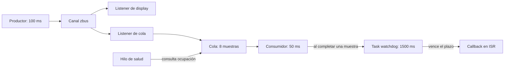

# Zephyr Training Environment

Welcome to the Zephyr RTOS training! This repository includes a ready-to-use
development environment based on Zephyr **4.4.0**, which you can set up in one of
three ways:

---

## Manual Zephyr Setup

Follow the following guide:
- [Getting Started Guide](https://docs.zephyrproject.org/4.4.0/develop/getting_started/index.html#).

Make sure to select appropriate OS and to perform all steps till
[Build the Blinky Sample](https://docs.zephyrproject.org/4.4.0/develop/getting_started/index.html#build-the-blinky-sample).

## Lecture 4 - Task 1: sistema de sensores con zbus

Este apartado describe el tag `l4-task1`. La versión actual se explica en Lecture 5.

La aplicación parte del ejemplo `l4-demo2` y conecta un productor con dos
observadores mediante un único canal, `sensor_chan`.

Cada mensaje contiene temperatura en miligrados Celsius, timestamp en
milisegundos y número de secuencia. Se generan 18 muestras, una cada 100 ms.
El sensor usa plazos absolutos para que el tiempo de publicación no se sume
al periodo; el reloj tiene resolución de 1 ms.

- **Display:** `ZBUS_LISTENER_DEFINE` ejecuta el callback sincrónicamente en el
  hilo `sensor`. Consulta el mensaje con `zbus_chan_const_msg()` y registra
  la actualización. El callback es breve y no duerme.
- **Logger:** `ZBUS_MSG_SUBSCRIBER_DEFINE` recibe una copia de cada mensaje
  mediante `zbus_sub_wait_msg()`, en su propio hilo. Una pausa de 350 ms
  simula el registro lento sin retrasar al productor ni al display.

Un subscriber regular recibe una notificación del canal y después lee su valor
actual. Aquí usamos el subscriber de mensajes del ejemplo para conservar cada
muestra antigua mientras el logger está ocupado. El pool de 32 buffers es
suficiente para esta demostración finita de 18 muestras. Un flujo continuo con
un consumidor permanentemente más lento necesitaría una política para limitar
la acumulación.

`main()` espera que ambos hilos terminen, comprueba los contadores y muestra
el resultado. El logger también verifica el canal y el orden de las secuencias.

### Compilar y ejecutar

Con el entorno de Zephyr del workspace activado, desde este repositorio:

```sh
west build -d build -b native_sim/native/64 app -- -DZEPHYR_TOOLCHAIN_VARIANT=host
./build/zephyr/zephyr.exe -stop_at=8
```

### Resultado verificado en native_sim

```text
[SENSOR] publish seq=0 temp=24000 mC tick=100
[DISPLAY-LIS] thread=sensor seq=0 temp=24000 mC tick=100
[LOGGER-MSG] thread=logger seq=0 temp=24000 mC latency=0ms tick=100
[SENSOR] publish seq=1 temp=24350 mC tick=200
[DISPLAY-LIS] thread=sensor seq=1 temp=24350 mC tick=200
...
[LOGGER-MSG] thread=logger seq=1 temp=24350 mC latency=251ms tick=451
...
[SENSOR] done published=18
...
[LOGGER-MSG] thread=logger seq=17 temp=29950 mC latency=4267ms tick=6067
[LOGGER-MSG] done received=18
[SUMMARY] published=18 displayed=18 logged=18
[SUMMARY] verification passed
```

La verificación automática del log confirmó las 18 secuencias y temperaturas,
intervalos de publicación de exactamente 100 ms y actualizaciones del display
en el mismo milisegundo de cada publicación, dentro del hilo `sensor`.
El logger recibió todas las copias en orden, con intervalos de 351 ms por el
redondeo del timeout al tick siguiente. El sensor terminó a los 1800 ms y el
logger a los 6067 ms: el retraso del logger no frenó las publicaciones.

Tag de entrega: `l4-task1`.

## Lecture 5 - Task 1: fiabilidad bajo presión

La rama `l5-homework` parte del tag `l4-task1`. Conserva el canal de sensores
zbus, el productor periódico y el listener de display. Para medir la presión,
la entrega al consumidor ahora pasa por una `k_msgq` de ocho muestras: otro
listener copia el mensaje con `K_NO_WAIT`. Si la cola está llena, descarta la
muestra nueva y registra su secuencia; el productor sigue publicando cada 100 ms.



### Watchdog y fallo simulado

`main()` llama a `task_wdt_init(NULL)` antes de iniciar los hilos. El consumidor
registra un canal con `task_wdt_add()` y lo alimenta con `task_wdt_feed()`
únicamente después de terminar una muestra. El hilo de salud nunca alimenta
ese watchdog.

Por defecto, después de procesar tres muestras, el consumidor ejecuta
`k_sleep(K_MSEC(2500))`. Durante esa pausa deja de consumir y de alimentar
el watchdog, mientras el productor continúa. El plazo de 1500 ms permite
observar primero la acumulación y luego el callback con la cola llena.

El callback se ejecuta en contexto de interrupción: solo guarda estadísticas
atómicas y emite un log diferido. Esta demostración usa el watchdog de software
sin respaldo hardware y registra el fallo sin reiniciar el sistema. El consumidor
retoma su trabajo cuando termina el sleep simulado; el callback no lo despierta.
Al finalizar, el consumidor elimina su canal de watchdog.

### Monitor de salud

El hilo de salud consulta `k_msgq_num_used_get()` aproximadamente cada 100 ms.
Registra el nivel de ocupación y emite una advertencia al alcanzar el 75 %
(`6/8`). Advierte al entrar en ese rango y vuelve a habilitar la advertencia
cuando la ocupación cae por debajo del umbral.

### Compilar y verificar

Con el entorno de Zephyr del workspace activado, desde este repositorio:

```sh
west build -d build/l5-task1 -b native_sim/native/64 app -- -DZEPHYR_TOOLCHAIN_VARIANT=host
python3 tests/verify_l5.py build/l5-task1/zephyr/zephyr.exe --mode stuck
```

El verificador ejecuta seis segundos de simulación, guarda el log completo en
`build/l5-task1/l5-stuck.log` y comprueba el periodo del productor, las secuencias
aceptadas y descartadas, la advertencia al 75 %, el orden de los eventos y el
callback a los 1500 ms de la última muestra completada.

Para observar todo el log directamente:

```sh
./build/l5-task1/zephyr/zephyr.exe -stop_at=6
```

### Resultado medido con bloqueo

| Tiempo | Observación |
| --- | --- |
| 351 ms | El consumidor termina su tercera muestra y comienza el sleep de 2500 ms. |
| 909 ms | El monitor advierte: cola al 75 %, `6/8`. |
| 1111 ms | El monitor observa la cola al 100 %, `8/8`. |
| 1200 ms | Se descarta la primera muestra nueva, secuencia 11. |
| 1851 ms | Vence el watchdog y se ejecuta el callback en ISR con la cola `8/8`. |
| 2852 ms | El consumidor retoma el procesamiento. |
| 4051 ms | Termina la demostración y se comprueban las estadísticas. |

```text
[SUMMARY] published=40 displayed=40 queued=23 processed=23 dropped=17
[SUMMARY] peak=8/8 warnings=1 watchdogs=1 watchdog_tick=1851
[SUMMARY] verification passed
```

Las 40 publicaciones mantuvieron intervalos de exactamente 100 ms. El display
recibió las 40 y el consumidor procesó, en orden, las 23 que entraron en la cola.
Las otras 17 se descartaron únicamente cuando la cola estaba llena.

### Control sin bloqueo

`app/healthy.conf` desactiva `CONFIG_HOMEWORK_STUCK_CONSUMER` para repetir la
misma pipeline sin el fallo simulado:

```sh
west build -d build/l5-healthy -b native_sim/native/64 app -- -DZEPHYR_TOOLCHAIN_VARIANT=host -DEXTRA_CONF_FILE=healthy.conf
python3 tests/verify_l5.py build/l5-healthy/zephyr/zephyr.exe --mode healthy
```

Resultado medido: 40 publicadas, 40 mostradas, 40 procesadas, cero pérdidas,
cero advertencias y cero callbacks del watchdog. La ocupación observada es
`0/8` porque el consumidor está esperando y recibe cada muestra directamente.

Tag de entrega: `l5-task1`.
